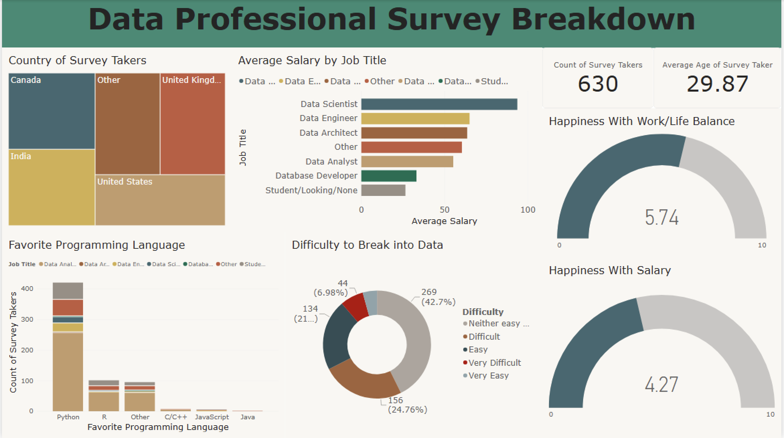

# Data Professional Survey Breakdown Dashboard

An interactive Power BI dashboard analyzing survey responses from 630 data professionals, providing insights into salary distributions, job satisfaction, preferred programming languages, and industry entry difficulty.

---

## Key Insights & Metrics

- **Survey Sample**: 630 respondents with an average age of 29.87 years.
- **Salary Leader**: Data Scientists report the highest average salary, followed by Data Engineers and Data Architects.
- **Top Programming Language**: Python is by far the most popular favorite language among survey takers across all roles.
- **Ease of Entry**: 42.7% found breaking into the data field neither easy nor difficult, while 24.8% found it difficult.
- **Satisfaction Ratings (Out of 10)**:
  - **Work/Life Balance**: `5.74 / 10`
  - **Salary Satisfaction**: `4.27 / 10`

---

## Tools Used

- **Power BI Desktop**: Data modeling, DAX measures, and visual design.
- **Power Query**: Data cleaning, transformation, and profiling.
- **Excel / CSV**: Raw data source.

---

## Visualisations Breakdown

1. **KPI Cards**: Total survey respondents and average respondent age.
2. **Treemap**: Breakdown of survey takers by country (United States, India, Canada, UK, Other).
3. **Bar Charts**:
   - Average Salary by Job Title
   - Favorite Programming Language by Job Title
4. **Donut Chart**: Difficulty rating of breaking into the data industry.
5. **Gauge Charts**: Work/Life Balance and Salary Happiness scores.

---

## 🚀 How to View
1. Clone or download this repository.
2. Open `Data Professional Survey.pbix` in [Power BI Desktop](https://powerbi.microsoft.com/desktop/).
